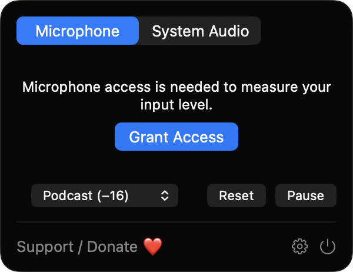
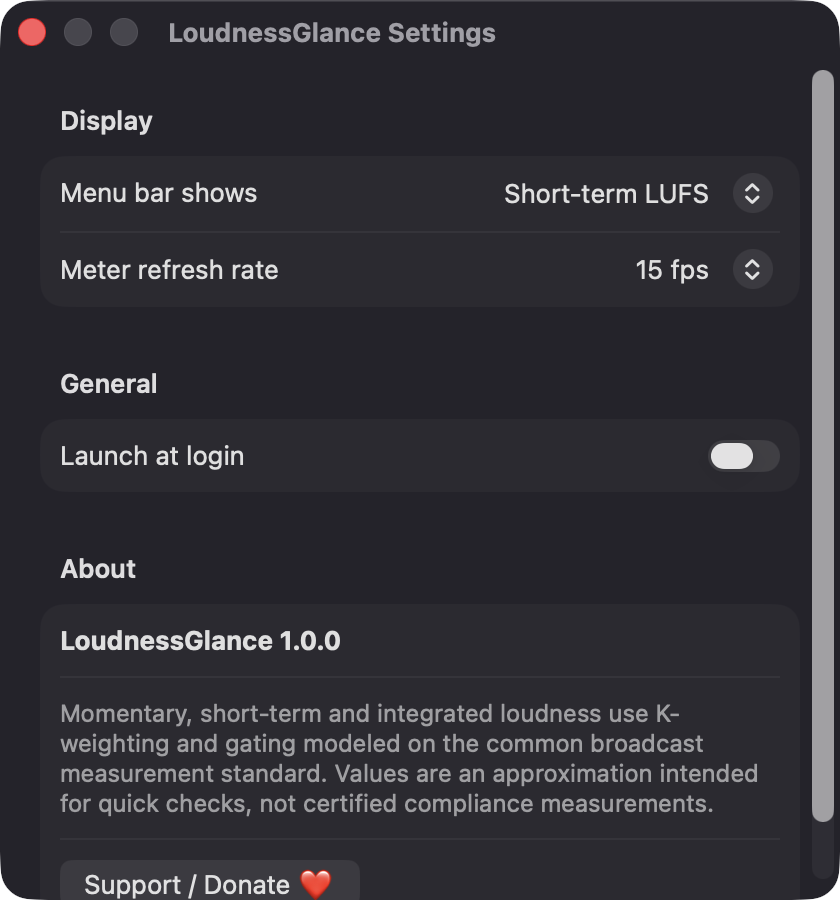
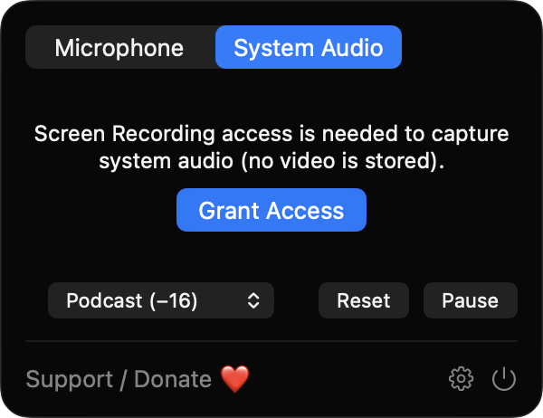

# LoudnessGlance

**🌐 Website:** [turhe123.github.io/loudness-glance](https://turhe123.github.io/loudness-glance/)

A menu bar loudness meter showing LUFS and peak levels of your mic or system audio in real time.

> 🆓 A free, open-source **LOUDMETER alternative** for macOS 14+. Native Swift, no accounts, no subscriptions, MIT licensed.


[](https://github.com/turhe123/loudness-glance/releases/latest)

## Why

LoudnessGlance is a free, open-source, 100% native, backend-free alternative to paid utilities in the *Audio* category. It was inspired by LOUDMETER ($9.99 one-time), a great idea for podcasters and video editors who want to check levels without opening a plugin window. LoudnessGlance is a simplified, clean-room take on that idea: everything runs locally, nothing is recorded, and nothing is sent anywhere.

## Features

- **Live menu bar readout** of short-term loudness (LUFS), or an icon-only mode.
- **Momentary (400 ms), short-term (3 s) and integrated loudness**, using K-weighting (two cascaded biquad filters computed for the actual sample rate, run with Accelerate) and absolute (−70 LUFS) plus relative (−10 LU) gating.
- **Sample peak in dBFS** with a peak-hold marker.
- **Source picker:** microphone (AVAudioEngine) or system audio (audio-only ScreenCaptureKit stream).
- **Target selector:** Podcast (−16), Streaming (−14) or Broadcast (−23), with green / amber / red coloring relative to the target and a target marker on the momentary bar.
- **Reset and Pause** controls.
- **Settings:** menu bar text vs. icon, meter refresh rate (10 / 15 / 30 fps), launch at login.
- **Robust capture:** rebuilds the filters when the sample rate or input device changes, restarts capture after sleep/wake, and keeps microphone mode usable if Screen Recording is denied.
- **Clear permission states:** a single button and a one-line reason when access is missing.
- Silence is shown as a dash; only block energies are stored for integrated loudness, so memory stays small.
- Menu bar–only app (no Dock icon), with a visible **Support / Donate ❤️** button.

> Values are an approximation intended for quick checks, not certified compliance measurements. Peak is sample peak, not true peak.

## Screenshots

<p align="center"></p>

<p align="center"><em>The menu bar panel with the Microphone/System Audio source picker, loudness target selector, Reset and Pause controls, and a one-click prompt to grant microphone access.</em></p>

<p align="center"></p>

<p align="center"><em>Settings let you choose a LUFS readout or icon-only menu bar, pick the meter refresh rate, and enable launch at login.</em></p>

<p align="center"></p>

<p align="center"><em>Switching the source to System Audio explains in one line why Screen Recording access is needed and that no video is stored.</em></p>

## Install

1. Download `LoudnessGlance-macOS.zip` from the [latest release](https://github.com/turhe123/loudness-glance/releases/latest).
2. Unzip it and move `LoudnessGlance.app` to `/Applications`.
3. Because the app is open source and not notarized, clear the quarantine flag:

   ```bash
   xattr -cr /Applications/LoudnessGlance.app
   ```

4. Right-click the app and choose **Open** the first time you launch it.

Requires macOS 14.0 or later.

## Build from source

```bash
brew install xcodegen
xcodegen generate
xcodebuild -project LoudnessGlance.xcodeproj -scheme LoudnessGlance -configuration Release -derivedDataPath ./build build
```

The app is produced at `build/Build/Products/Release/LoudnessGlance.app`. No third-party Swift packages are used.

## Permissions

| Permission | When | Why |
| --- | --- | --- |
| **Microphone** | Source is *Microphone* | To measure the loudness of your input. Audio is analyzed locally and never recorded or sent anywhere. |
| **Screen Recording** | Source is *System Audio* | macOS requires this permission for ScreenCaptureKit audio capture. Only audio is used; the tiny video frames are discarded and nothing is stored. After enabling it, quit and reopen the app. |

LoudnessGlance does not request Accessibility access. If a permission is missing, the panel shows a button to grant it (or to open System Settings if it was denied).

## Built with AI

LoudnessGlance was written by [Claude Code](https://claude.com/claude-code) inside an automated pipeline, from a plain-English spec. No code, binaries or assets from any commercial app were used; it is a clean-room reimplementation of a feature set, not a copy.

What that means in practice:

- The full source is in this repo under the MIT license. Read it before you run it.
- No network calls, no analytics, no third-party dependencies. Only Apple frameworks.
- Ad-hoc signed and not notarized, which is why Gatekeeper warns on first launch.
- It has had less human review than a hand-written app. Bug reports and pull requests are welcome.

## Support ❤️

If LoudnessGlance is useful to you, you can support its development:

[Support Or (Leo) Davidai ❤️ on Ko-fi](https://ko-fi.com/leodavidai)

## More free Mac apps

LoudnessGlance is one of [60 free, open-source Mac utilities](https://github.com/turhe123/mac-apps) built the same way: native Swift, no accounts, no telemetry. Browse the full gallery at [turhe123.github.io/mac-apps](https://turhe123.github.io/mac-apps/).

## License

MIT © Or Davidai Bachar
